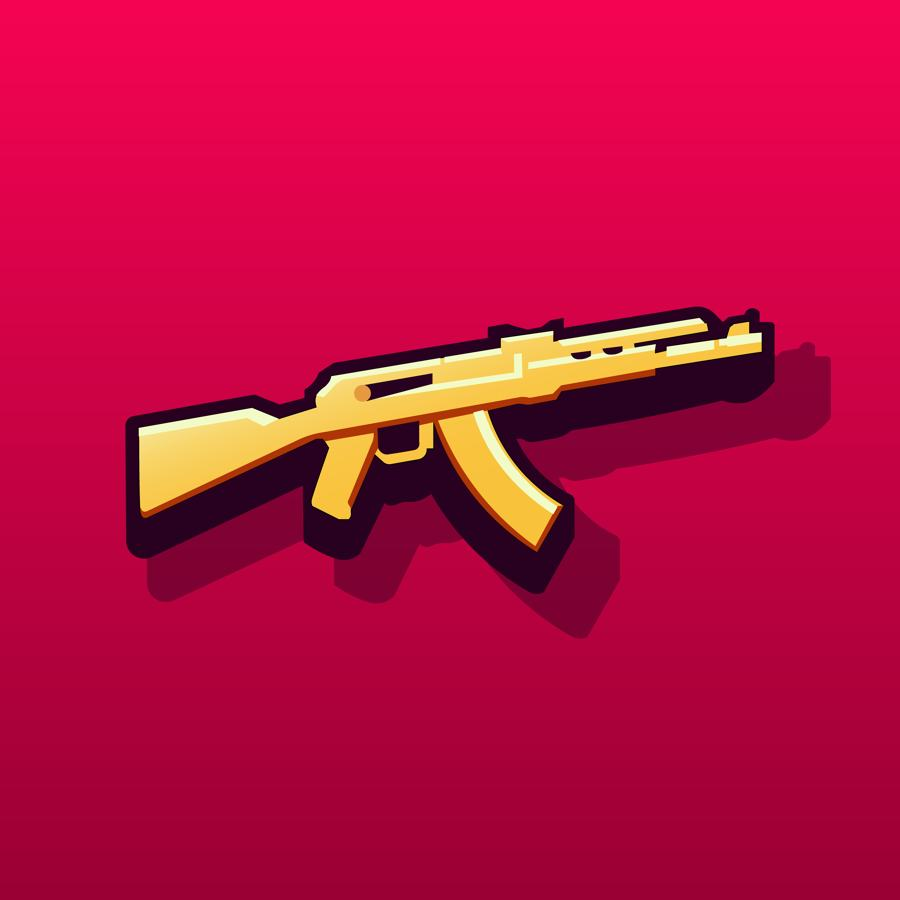

## Hi, I'm Mertcan 👋

**Unity Game Developer & Graphic Designer** from İzmir, Türkiye.

I'm building **[Golden Guns 3D](https://github.com/MeeCooTR/golden-guns-3d-showcase)** solo under my studio **Outworld Interactive**: an isometric online shooter for Android, now in closed beta on Google Play.

- 🎮 Unity 6 · C# · Netcode for GameObjects · Unity Gaming Services
- 🗺️ Level design: greybox → final, built around an isometric camera
- 🤖 AI bots with A* pathfinding, procedural animation, game feel
- 🎨 Graphic design: Illustrator, Photoshop, Figma, After Effects
- 🎬 Devlog series *“Developing a Game Solo”* (TR / EN)
- 🔎 **Open to junior Unity developer and graphic designer roles**, on-site in İzmir or remote

📫 uckusmertcan0@gmail.com
